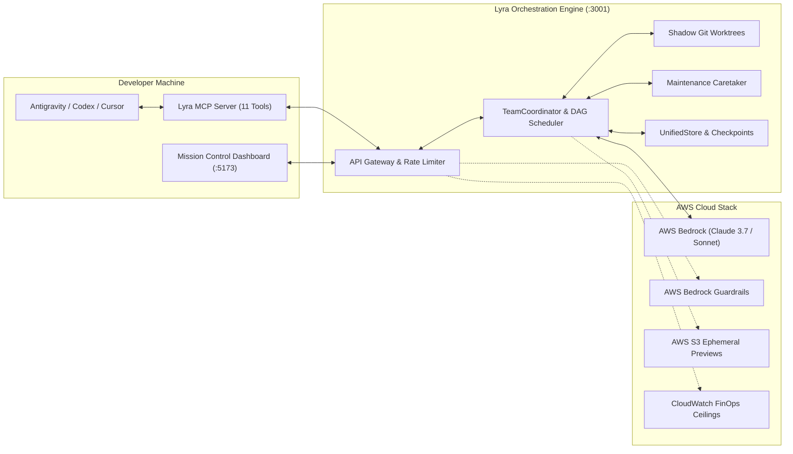

# Lyra — Autonomous Cloud Swarm & Orchestration Engine

Lyra is a **headless, harness-agnostic autonomous engineering platform** designed to execute complex, multi-stage software development swarms in the cloud while preserving zero disruption on your local workspace.

Rather than competing with developer chat interfaces, Lyra plugs directly into **Google Antigravity**, **OpenAI Codex CLI**, **Claude Code**, and **Cursor** via an **11-tool Model Context Protocol (MCP) server** and secure REST gateway.

---

## 🏛️ Architecture at a Glance



For complete architectural deep-dives, sequence diagrams, and lifecycle details, see [docs/architecture-and-features.md](docs/architecture-and-features.md).

---

## ⚡ Core Capabilities

- **Headless MCP Integration (11 Standardized Tools)**: Dispatch swarms (`lyra_dispatch_task`), stream diffs (`lyra_inspect_diff`), resolve merge conflicts (`lyra_resolve_conflict`), run dynamic QA fuzzing (`lyra_run_qa_sandbox`), and open GitHub Pull Requests (`lyra_create_github_pr`).
- **Zero-Disruption Shadow Worktrees**: Workers execute in isolated Git worktrees (`.lyra/worktrees/*`). Your local working tree, branch, and staged files are never modified during execution.
- **Task Resiliency & Checkpoint Resume**: Fault-tolerant state machine surviving laptop sleep, process restarts, rate limits, and AWS Spot container evictions. Succeeded tasks are never re-run.
- **AWS Bedrock Guardrails**: Scans prompts, shell commands, and model completions to block secret leakage (AWS keys, GitHub tokens, private keys) and destructive commands (`rm -rf`, disk wipes).
- **Ephemeral S3 Previews**: Deploys static build artifacts to `s3://<bucket>/previews/<tenant>/<runId>/index.html` with CloudFront CDN links embedded directly in PRs.
- **FinOps Spend Ceilings**: Real-time AWS CloudFormation cost estimator with configurable per-run ($2.00) and monthly ($25.00) budget caps that halt runaway model spend.
- **Autonomous Grounded Codebase Caretaker**: Audits and refactors deprecated JavaScript/TypeScript APIs and outdated packages strictly grounded in official documentation (MDN, Node docs, GitHub Releases).
- **Lyra Mission Control**: High-contrast, 2-tab web dashboard displaying live swarms, collapsible diffs, test check status, token/USD telemetry, and AWS settings.

---

## 🚀 Quickstart

### Prerequisites
- [Bun](https://bun.sh) (v1.2+) or Node.js (v20+)
- Git installed and available on PATH
- AWS credentials configured (optional, for Bedrock cloud execution)

### 1. Start the Gateway and Mission Control
```bash
bun run dev
```
- **Lyra Gateway & Hub**: `http://localhost:3001`
- **Lyra Mission Control**: `http://localhost:5173`

### 2. Verify System Health & Run Tests
```bash
# Typecheck validation (0 errors)
bun run typecheck

# Full test suite (89 passing tests across 29 test suites)
bun test

# Live end-to-end simulation
bun run scripts/demo-harness-integration.ts
```

### 3. Connect to Antigravity, Cursor, or Claude Code
Add to your MCP settings (`antigravity.json` or `claude_desktop_config.json`):

```json
{
  "mcpServers": {
    "lyra_harness": {
      "command": "bun",
      "args": [
        "run",
        "/Users/taufeeqali/Projects/Lyra/scripts/mcp-server-stdio.ts"
      ],
      "env": {
        "LYRA_GATEWAY_URL": "http://localhost:3001",
        "LYRA_GATEWAY_API_KEY": "lyra-harness-default-secret"
      }
    }
  }
}
```

---

## 📚 Documentation
- [Architecture & Feature Master Guide](docs/architecture-and-features.md)
- [REST API Gateway Specification](docs/api.md)
- [OpenAPI 3.0 Schema](docs/openapi.yaml)
