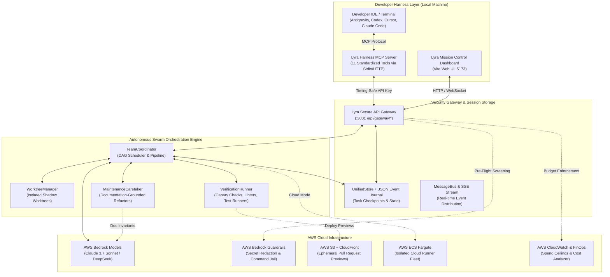
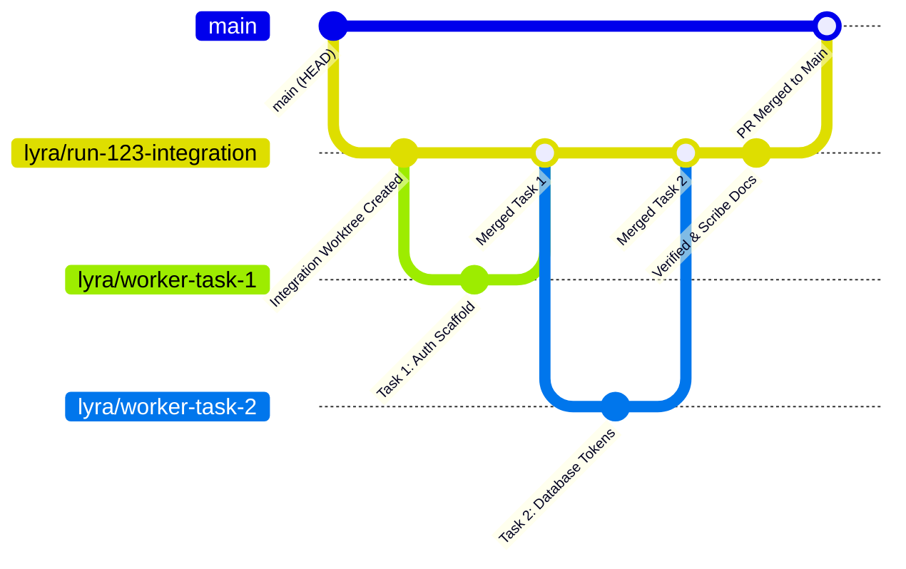
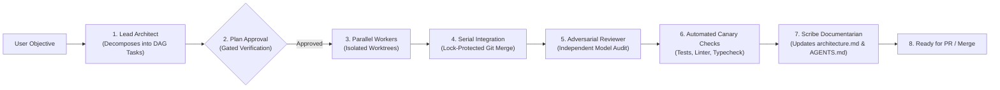
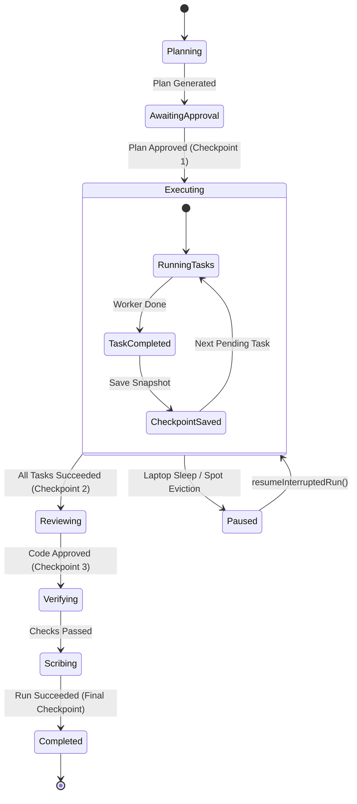
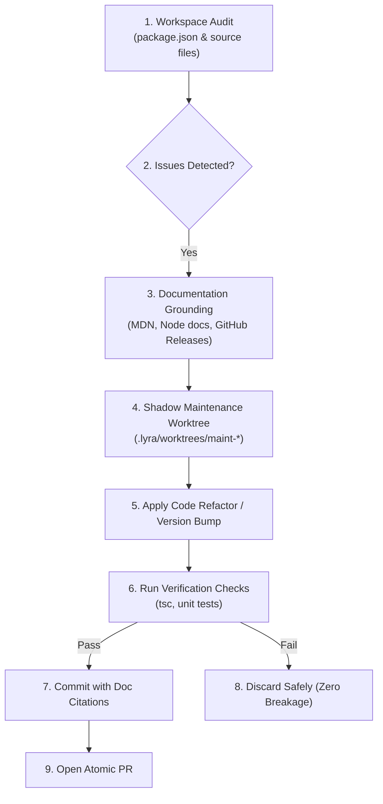
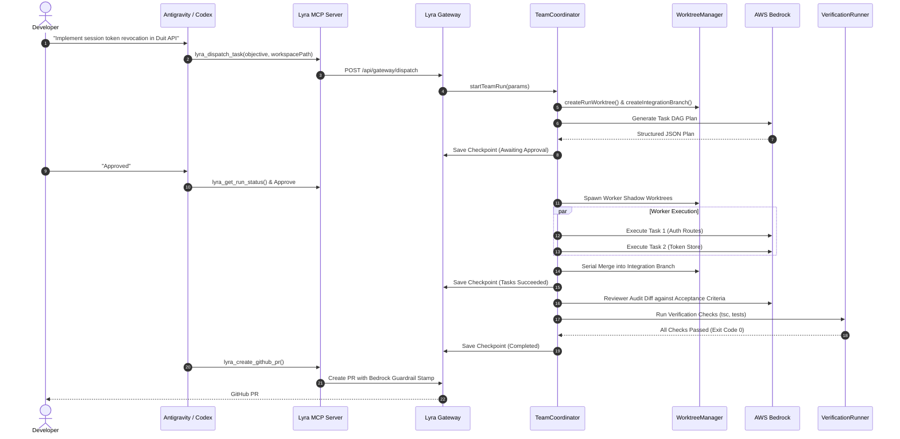

# Lyra: Autonomous Cloud Swarm & Orchestration Engine

Lyra is a **headless, harness-agnostic autonomous engineering platform** designed to execute complex, multi-stage software development swarms in the cloud while preserving zero disruption on your local workspace.

Rather than duplicating chat interfaces, Lyra plugs directly into your existing development tools (**Antigravity**, **OpenAI Codex CLI**, **Claude Code**, **Cursor**) via a **11-tool Model Context Protocol (MCP) server** and REST gateway. It orchestrates parallel worker fleets across isolated Git shadow worktrees, enforces AWS Bedrock security guardrails and FinOps budget ceilings, and deploys ephemeral web previews to AWS S3.

---

## 🏛️ System Architecture



---

## 🚀 Complete Feature Catalog

### 1. Headless Orchestration & Standardized MCP Server (11 Tools)
Lyra operates as a background daemon exposing 11 standardized MCP tools to external AI harnesses:

| MCP Tool Name | Purpose & Workflow |
| :--- | :--- |
| `lyra_dispatch_task` | Dispatches an autonomous software task to the cloud swarm, establishing a plan DAG. |
| `lyra_get_run_status` | Returns live status, active tasks, check outcomes, and token/dollar telemetry. |
| `lyra_get_pending_requests` | Queries pending file excerpt requests and sensitive permission requests. |
| `lyra_provide_file_context` | Delivers targeted local file excerpts to remote agents without uploading the entire repo. |
| `lyra_respond_permission` | Approves or denies elevated permissions (git push, network calls, file deletions). |
| `lyra_inspect_diff` | Returns line-by-line unified git patches across active worktrees. |
| `lyra_resolve_conflict` | Safely resolves file merge conflicts between workers from the local harness. |
| `lyra_run_qa_sandbox` | Executes dynamic QA, fuzzing, and stress testing against live preview URLs. |
| `lyra_create_github_pr` | Opens an authenticated GitHub Pull Request with Guardrail audit badges. |
| `lyra_dispatch_and_pr` | 1-shot autonomous workflow: dispatches, monitors tests, and creates PR upon success. |
| `lyra_run_maintenance` | Runs documentation-grounded package upgrades, deprecation modernizations, and cleanup. |

---

### 2. Zero-Disruption "Shadow Worktrees"
Traditional coding assistants operate directly inside your active workspace, locking files and causing git churn while you code.

Lyra utilizes **Git Shadow Worktrees** (`.lyra/worktrees/run-*`):
- Multiple workers operate simultaneously in dedicated worktrees branching from `HEAD`.
- Each worker commits changes atomically to a dedicated task branch.
- Changes are serially integrated into a run-level `integration` branch.
- **Your active working directory, branch, and staged files are never touched.**



---

### 3. Multi-Agent Parallel Assembly Line
When a task is dispatched, Lyra coordinates a structured multi-role pipeline:



1. **Lead Architect**: Analyzes problem space, avoids XY traps, outputs structured JSON plan with dependencies.
2. **Parallel Workers**: Executes independent tasks concurrently up to configured `concurrencyLimit`.
3. **Adversarial Reviewer**: Audits integrated diff against original acceptance criteria using a distinct model architecture.
4. **Verification Runner**: Discovers and runs project checks (`tsc`, `bun test`, database migration canaries).
5. **Scribe Documentarian**: Automatically updates `docs/architecture.md` and `AGENTS.md` before completion.

---

### 4. Task Resiliency & Checkpoint Resume State Machine
Swarm runs are fault-tolerant state machines that survive process restarts, network outages, laptop sleep, and cloud spot evictions:



- **Checkpoint Snapshot**: Persists completed task IDs, failed task IDs, working branch names, worktree locations, and test outcomes to `run-<runId>-checkpoint.json`.
- **Zero Token Duplication**: Resuming an interrupted run skips all already-succeeded tasks and picks up immediately at the next uncompleted task.

---

### 5. AWS Cloud Integrations

#### A. AWS Bedrock Guardrails ([`server/bedrockGuardrails.ts`](file:///Users/taufeeqali/Projects/Lyra/server/bedrockGuardrails.ts))
Screens agent prompts, shell commands, and generated code:
- **Secret Redaction**: Detects and redacts AWS access keys (`AKIA...`), GitHub PATs (`ghp_...`), and RSA/SSH private keys.
- **Destructive Command Jail**: Blocks destructive shell injections (`rm -rf /`, raw disk overwrites `dd if=/dev/zero`, fork bombs).
- **Cloud Policy Integration**: Integrates directly with AWS Bedrock `ApplyGuardrailCommand`.

#### B. Ephemeral S3 Previews ([`server/previewDeployer.ts`](file:///Users/taufeeqali/Projects/Lyra/server/previewDeployer.ts))
- Builds static assets or generates an automated run summary HTML.
- Deploys to `s3://<bucket>/previews/<tenant>/<runId>/index.html` distributed via CloudFront.
- Automatically embeds the live preview URL into GitHub Pull Requests.
- Falls back to local dev servers (`http://localhost:<port>`) in offline mode.

#### C. FinOps Spend Ceilings ([`server/finopsAnalyzer.ts`](file:///Users/taufeeqali/Projects/Lyra/server/finopsAnalyzer.ts))
- Computes estimated infrastructure delta costs for CloudFormation templates (NAT Gateways, ALBs, Fargate).
- Enforces strict spending ceilings (e.g. max \$2.00 per run, \$25.00 monthly cap).
- Emits warnings at 85% budget consumption and halts dispatches when limits are reached.

#### D. AWS Fargate Cloud Execution ([`server/ecsNativeDispatcher.ts`](file:///Users/taufeeqali/Projects/Lyra/server/ecsNativeDispatcher.ts))
- Supports hybrid execution: dispatches tasks locally by default, or cloud-bursts onto ECS Fargate containers when `cloudExecution: true` is requested.

---

### 6. Autonomous Codebase Caretaker ([`server/maintenanceCaretaker.ts`](file:///Users/taufeeqali/Projects/Lyra/server/maintenanceCaretaker.ts))
Routine, non-disruptive codebase maintenance grounded in official documentation:



- **Grounded Deprecation Modernization**: Replaces deprecated APIs (`.substr()` -> `.slice()`, `new Buffer()` -> `Buffer.from()`, `escape()` -> `encodeURIComponent()`) citing official documentation.
- **Major Package Upgrades**: Updates packages (Zod, TypeScript, Lucide, etc.) and refactors breaking changes.
- **Dead Code Pruning**: Cleans up leftover debug statements and unreferenced code.

---

### 7. Lyra Mission Control Web Dashboard ([`src/App.tsx`](file:///Users/taufeeqali/Projects/Lyra/src/App.tsx))
A focused, 2-tab operational visualizer built in React, Vite, and Tailwind CSS:
1. **Active Swarms & Worktrees**:
   - Real-time stage tracker (Planning, Executing, Reviewing, Verifying, Completed).
   - Task DAG checklist with status indicators and assigned harnesses.
   - Collapsible line-by-line unified git diff viewer.
   - Real-time FinOps telemetry (tokens used, model ID, estimated cost in USD, elapsed time).
2. **Cloud & Settings**:
   - AWS Bedrock region and model selection.
   - GitHub Integration status (`@tfq26` / GitHub App).
   - FinOps budget limits and spending guardrails.

---

## 🔄 End-to-End Life of a Task

The following sequence diagram illustrates an external harness dispatching a feature task to Lyra:



---

## 🛠️ Quickstart & Local Setup

### 1. Prerequisites
- **Runtime**: [Bun](https://bun.sh) (v1.2+) or Node.js (v20+)
- **Git**: Installed and available in PATH (required for isolated worktrees)
- **AWS Credentials**: (Optional for cloud execution) `AWS_REGION=us-east-1`, configured via standard AWS CLI or environment variables.

### 2. Starting Lyra
```bash
# Clone and enter repo
cd /Users/taufeeqali/Projects/Lyra

# Start both Gateway Server (:3001) and Mission Control (:5173)
bun run dev
```

### 3. Running Verification & Typecheck
```bash
# Verify TypeScript typecheck (0 errors)
bun run typecheck

# Run full automated test suite (89 tests)
bun test

# Run live harness demonstration script
bun run scripts/demo-harness-integration.ts
```

### 4. Connecting Antigravity / Cursor / Claude Code via MCP
Add the following to your MCP client configuration (`antigravity.json` or `claude_desktop_config.json`):

```json
{
  "mcpServers": {
    "lyra_harness": {
      "command": "bun",
      "args": [
        "run",
        "/Users/taufeeqali/Projects/Lyra/scripts/mcp-server-stdio.ts"
      ],
      "env": {
        "LYRA_GATEWAY_URL": "http://localhost:3001",
        "LYRA_GATEWAY_API_KEY": "lyra-harness-default-secret"
      }
    }
  }
}
```

---

## 📁 Repository Directory Structure

```
Lyra/
├── .agents/skills/lyra-harness/ # Antigravity native skill definition
├── docs/
│   ├── architecture-and-features.md # This document
│   ├── api.md                  # REST Gateway specification
│   └── openapi.yaml            # OpenAPI 3.0 specification
├── infra/aws/                  # AWS CloudFormation template (ECS, S3, ALB)
├── scripts/
│   ├── demo-harness-integration.ts # End-to-end simulation script
│   └── mcp-server-stdio.ts     # Standard MCP stdio transport bridge
├── server/
│   ├── bedrockGuardrails.ts    # AWS Bedrock Guardrails & secret redaction
│   ├── ecsNativeDispatcher.ts  # AWS ECS Fargate runner fleet dispatcher
│   ├── finopsAnalyzer.ts       # CloudWatch spending ceilings & CFN estimator
│   ├── gateway.ts              # Timing-safe API gateway & rate limiter
│   ├── harnessMcpServer.ts     # Standardized 11-tool MCP server
│   ├── maintenanceCaretaker.ts # Documentation-grounded maintenance swarm
│   ├── previewDeployer.ts      # AWS S3 ephemeral preview pipeline
│   ├── teamCoordinator.ts      # Swarm orchestrator & checkpoint resume
│   ├── unifiedStore.ts         # Persistent event journal & run checkpoints
│   ├── verificationRunner.ts   # Automated canary and test runner
│   └── worktreeManager.ts      # Git shadow worktree isolation engine
├── src/                        # Lyra Mission Control Web Dashboard
│   ├── App.tsx                 # 2-tab Mission Control UI
│   └── lib/platform.ts         # Web platform adapter
├── package.json
└── tsconfig.json
```
